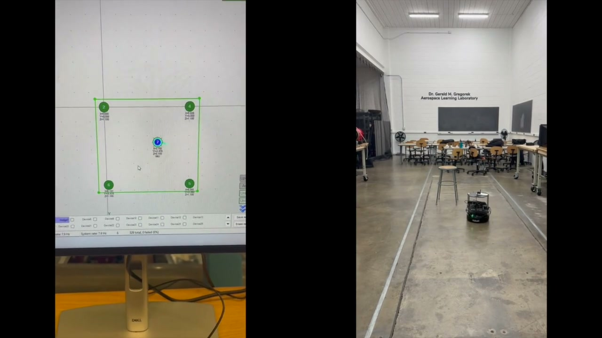
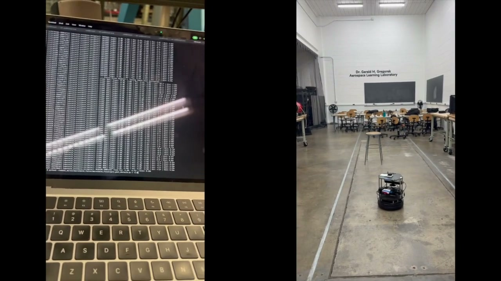
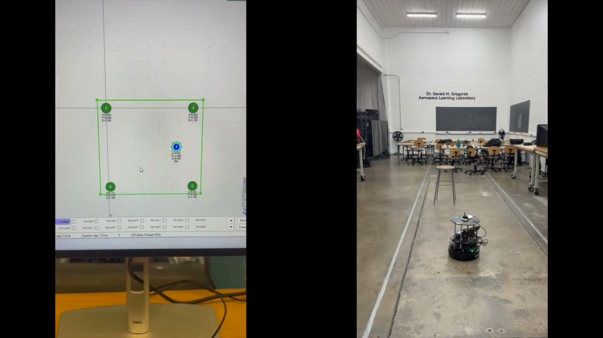

# Welcome to the UAS Research Group

We are an undergraduate research team at **The Ohio State University** working in the **Dr. Gerald M. Gregorek Aerospace Learning Laboratory (BOLZ Lab)**. Our group designs, builds, and programs autonomous unmanned aerial and ground systems for GPS-denied indoor environments.

Our work spans hardware integration, embedded systems, ROS 2 robotics, flight controller programming, and indoor positioning — giving students hands-on experience across the full autonomy stack.

<p align="center">
  
</p>

<p align="center"><i>TurtleBot2 autonomously navigating the Aerospace Learning Laboratory using Marvelmind indoor positioning</i></p>

---

## Active Projects

| Project | Description | Status |
|---|---|---|
| [CrowDrone](./CrowDrone/) | 10.5" quadcopter with Pixhawk 6C + ArduPilot, indoor positioning via Marvelmind NMEA | Active |
| [GroundRobots](./GroundRobots/turtlebot-navigation/) | TurtleBot2 with Raspberry Pi 5 + ROS 2 Jazzy, Marvelmind positioning + MicroStrain IMU | Active |
| [MessengerDrone](./MessengerDrone/) | Messenger drone platform | New |

<p align="center">
  
  
</p>

<p align="center"><i>Left: ROS 2 nodes streaming on the terminal while the robot runs. Right: Marvelmind dashboard tracking the robot (blue) among stationary beacons (green).</i></p>

---

## What We Work With

- **Indoor Positioning** — Marvelmind ultrasonic/UWB system for cm-accurate localization without GPS
- **Flight Controllers** — Pixhawk 6C running ArduPilot, configured for indoor flight
- **ROS 2** — Jazzy on Raspberry Pi 5, running sensor fusion, Nav2 path planning, and custom controllers
- **Sensor Fusion** — Combining Marvelmind position with MicroStrain IMU heading for robust odometry
- **Embedded Linux** — Raspberry Pi setup, networking, udev rules, serial device management

---

## Devices

| Platform | Hostname | Username | SSH |
|---|---|---|---|
| CrowDrone Pi | `bolzpi` | `pi` | `ssh pi@bolzpi.local` |
| Ground robot Pi | `bolzpi2` | `uas` | `ssh uas@bolzpi2.local` |
| Messenger drone Pi | `messenger` | `messengerpi` | `ssh messengerpi@messenger.local` |

---

## Documentation

| Doc | Description |
|---|---|
| [CONTRIBUTING.md](./CONTRIBUTING.md) | **Start here if you're new.** How to fork, clone, commit, and open a pull request. |
| [MARVELMIND.md](./MARVELMIND.md) | Shared Marvelmind indoor positioning guide — beacon setup, protocol switching, troubleshooting. |
| [Pi_Hotspot_SSH_Guide.md](./Pi_Hotspot_SSH_Guide.md) | How to connect to a Pi over a phone hotspot and SSH. |
| [SD_CARD_BACKUPS.md](./SD_CARD_BACKUPS.md) | How to back up and restore Pi SD card images. |
| [CrowDrone/DRONE_INTEGRATION.md](./CrowDrone/DRONE_INTEGRATION.md) | Marvelmind/Pixhawk wiring, ArduPilot parameters, EKF3 configuration. |
| [GroundRobots/.../README.md](./GroundRobots/turtlebot-navigation/README.md) | Full ground robot build guide — 20 phases from Pi setup to autonomous navigation. |

---

## Repository Structure

```
UAS_BOLZ/
├── CrowDrone/                          # Drone platform (pymavlink + Pixhawk)
├── MessengerDrone/                     # Messenger drone platform (new)
├── GroundRobots/turtlebot-navigation/  # Ground robot platform (ROS 2 + Nav2)
├── media/                              # Images for documentation
├── CONTRIBUTING.md                     # How to fork and contribute (start here)
├── MARVELMIND.md                       # Shared indoor positioning guide
├── Pi_Hotspot_SSH_Guide.md             # SSH and networking guide
├── SD_CARD_BACKUPS.md                  # Pi SD card backup/restore instructions
└── README.md                           # This file
```

---

## Getting Involved

New to the team? Here's how to get started:

1. **Read [CONTRIBUTING.md](./CONTRIBUTING.md)** — walks you through Git, forking, and submitting code (no experience needed)
2. **Pick a project** from the [Active Projects](#active-projects) table and read its docs
3. **Set up SSH** using the [Pi Hotspot Guide](./Pi_Hotspot_SSH_Guide.md) to connect to the hardware
4. **Ask questions** — open a GitHub Issue or reach out to the team

---

## Contact

For questions about this project, reach out to **Dhruv Chavan** — [chavan.36@osu.edu](mailto:chavan.36@osu.edu)

---

*UAS Research Group — BOLZ Lab, The Ohio State University*
